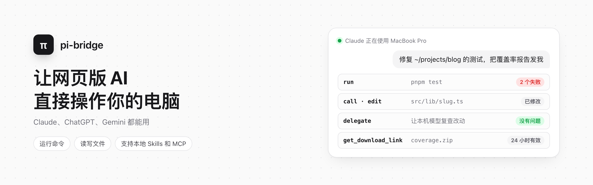

# pi-bridge



pi-bridge 让 Claude、ChatGPT 和 Gemini 网页版直接操作你的电脑：运行命令、读写文件，调用 [Pi](https://pi.dev) 已安装的 Skills、扩展和 MCP 服务器，还可以把任务委派给本机模型，或通过临时链接传输文件。

它由两部分组成：部署在 Cloudflare Workers 上的服务端，提供网页版接入用的 MCP 地址；运行在电脑上的 `pi-bridge` 命令行，负责连接服务端并在本机执行。一个服务端可以供多人使用，每人可以连接多台电脑。使用分三步：部署服务端 → 连接电脑 → 在网页版 AI 中添加连接器。如果管理员已经为你创建好账号，可以直接从[电脑连接](#电脑连接)开始。

## 服务端部署

需要一个 Cloudflare 账号并在控制台先启用 R2，免费套餐即可（邮件功能除外）。推荐使用「Fork 后部署」，方便后续升级；只想快速体验可以使用「一键部署」。

### Fork 后部署

1. [Fork 本仓库](https://github.com/cr-zhichen/pi-bridge/fork)。
2. 在 Cloudflare 控制台打开 **Workers & Pages → Create → Import a repository**，选择你的 Fork。
3. 在构建设置中把 **Root directory** 设为 `packages/server`，其余保持默认，部署。
4. 打开这个 Worker 的 **Settings → Variables and Secrets**，按下方[配置项](#配置项)添加 `ADMIN_KEY`（类型选 Secret）。

升级时在 Fork 页面点击 **Sync fork → Update branch**，Cloudflare 会自动重新部署，用户和设备数据都会保留。

### 一键部署

[](https://deploy.workers.cloudflare.com/?url=https://github.com/cr-zhichen/pi-bridge/tree/main/packages/server)

按页面提示连接 GitHub 并填写 `ADMIN_KEY`，Cloudflare 会在你的 GitHub 账号下创建一个独立仓库并完成部署。这个仓库不会随上游更新，需要长期使用时建议改用 Fork 后部署。

### 配置项

在 Worker 的 **Settings → Variables and Secrets** 中设置。

| 配置项               | 作用                                               | 默认值       |
| -------------------- | -------------------------------------------------- | ------------ |
| `ADMIN_KEY`          | 登录管理页 `/admin` 的密钥，请设置足够长的随机字符 | 无，必须设置 |
| `EMAIL_FROM`         | 发件地址，留空时关闭邮件功能，需要 Workers Paid    | 空           |
| `ALLOW_REGISTRATION` | 设为 `true` 开放自助注册                           | `false`      |

### 用户管理

在浏览器打开 `https://<服务地址>/admin`（`<服务地址>` 为 Worker 的访问地址，例如 `*.workers.dev` 或自定义域名），用 `ADMIN_KEY` 登录，填写用户名创建用户。创建后页面会显示登录地址、用户名和初始密码，只显示一次，请转交给对方。

用户登录并修改初始密码后，在账号页自行添加电脑、连接网页版 AI。管理员看不到用户的密钥。

暂停某个用户的使用可点「禁用」，之后可以重新启用。「删除」无法恢复，用户的设备连接、授权和临时文件链接都会失效。

### 自助注册（可选）

发送邮件需要 Workers Paid 套餐。

1. 在 Cloudflare 启用 [Email Sending](https://developers.cloudflare.com/email-service/get-started/send-emails/) 并验证发信域名。
2. 设置 `EMAIL_FROM` 为该域名下的发件地址，再把 `ALLOW_REGISTRATION` 设为 `true`。

之后登录页会出现「注册账号」，使用者验证邮箱后即可登录。只设置 `EMAIL_FROM` 时不开放注册，但已有用户可以绑定邮箱、用邮箱登录和找回密码。

### 临时文件清理（可选）

对话中生成的临时下载链接 24 小时后失效，但文件仍留在 R2 中。在 Worker 的 **Bindings** 找到存储桶 `TRANSFER_FILES`，[添加生命周期规则](https://developers.cloudflare.com/r2/buckets/object-lifecycles/#dashboard)，把前缀 `transfers/` 下的对象设为 1 天后删除。存储桶请保持私有。

## 电脑连接

支持 macOS、Windows 和 Linux。电脑需要先安装 [Pi](https://pi.dev) 0.99 或更高版本，以及 [Node.js](https://nodejs.org) 22.19 或更高版本。pi-bridge 使用电脑上安装的 Pi，网页版能用的扩展、Skills 和 MCP 与终端里的 `pi` 相同。

登录账号页 `https://<服务地址>`，在「我的电脑」点「添加电脑」（电脑名称可留空），按页面生成的命令依次安装、登录并启动：

```bash
npm install -g @zgccrui/pi-bridge
pi-bridge login https://<服务地址> <密钥>
pi-bridge start
```

`pi-bridge start` 在终端前台运行，关闭终端即断开。需要开机后自动在后台运行时，改用 `pi-bridge service install`（设置后会立即启动），取消用 `pi-bridge service uninstall`。

连接成功后，账号页会显示这台电脑在线。每台电脑使用独立密钥，电脑丢失或不再使用时，在账号页移除那一台即可。

| 命令                          | 作用                                     |
| ----------------------------- | ---------------------------------------- |
| `pi-bridge status`            | 查看连接状态和版本，有新版本时会提示     |
| `pi-bridge update`            | 更新到最新版本，已启用的后台服务自动重启 |
| `pi-bridge rename <电脑名称>` | 修改电脑名称                             |

## 网页版 AI 接入

连接至少一台电脑后，打开账号页的「连接网页版 AI」，选择 Claude、ChatGPT 或 Gemini 标签页，按页面提示添加连接器。

添加后会跳转到授权页。选择允许连接器访问的电脑，也可以勾选「允许访问全部电脑」（包含以后添加的电脑）。之后可在账号页的「已授权的应用」中随时修改或撤销。

> [!WARNING]
> 连接器拥有与你在终端中相同的权限，可以运行任意命令、修改或删除文件。只授权给你信任的 AI 账号。

接入完成后，在对话中告诉 AI 要操作的目录和任务即可，例如“修复 ~/projects/blog 的测试，把覆盖率报告发我”。如果连接器可以访问多台电脑，再说明用哪一台。

客户端不支持 OAuth 时，在账号页展开「不支持 OAuth？使用带密钥的地址」，填写名称并选择电脑后生成专属地址（只显示一次）。添加到客户端时，身份验证选择「无」或「无需登录」。这个地址等同于访问凭证，泄露后请立即在账号页删除。

## Pi 委派

如果本机 Pi 已配置可用模型，可以把一部分任务委派给本机 Pi 执行。在账号页「我的电脑」中打开目标电脑的「Pi 委派」开关，之后在对话中说明使用条件即可，例如「修复这组测试，需要第二意见时可以用 Pi」。要指定模型或思考等级，直接在对话里说明。

换到新对话后，可以请 AI 在原电脑的原目录查找最近的 Pi 委派，再选一条继续。

## 许可证

[MIT](LICENSE)

## 社区

欢迎到 [LINUX DO](https://linux.do) 社区交流和反馈。
